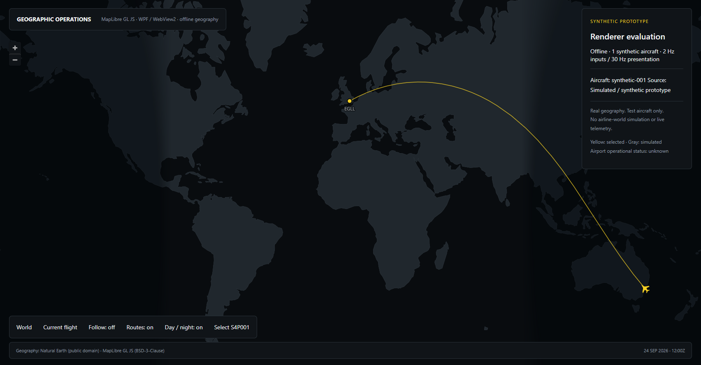

# Checkpoint 7.21 — Map V2 architecture, selection and isolated prototype

**Complete. Recommend GO for the bounded 7.22 implementation below.** MapLibre GL JS in WebView2 is the recommended renderer, subject to production-host and performance gates. This checkpoint does not enable it in Operations. All existing production source, tests, solution, packaging and operational behavior remain unchanged from `3b51b5c`.

Local branch: `codex/checkpoint-7.21`. No installation, GitHub push, provider subscription or API key was required. Production Map V2 and the airline-world engine have not begun.

## 1. Renderer candidates investigated

MapLibre GL JS/WebView2; official MapLibre Native FFI/C#; community MapLibre Native WPF wrapper; Mapbox GL JS; Esri ArcGIS Maps SDK for .NET; Mapsui WPF; custom WPF/Skia GPU rendering; CesiumJS. These were researched against current published status, not dismissed from historical assumptions about Windows support.

## 2. Current-source evidence

Research date: 24 September 2026. The [renderer source ledger](map-v2/renderer-alternatives.md) links official documentation, tagged source, licenses and publisher packages. The [data and solar ledger](map-v2/data-sources-and-solar.md) covers Natural Earth, OSM service policies, hosted vector providers, PMTiles, NOAA and restricted solar-code redistribution.

The built versions are MapLibre GL JS **6.11.2** and WebView2 SDK **1.0.4191.47**, with the workstation's installed runtime **153.0.4234.48**. Package lock, SHA-512-checked renderer archive and retained license make the prototype reproducible. See [MapLibre docs](https://maplibre.org/maplibre-gl-js/docs/), [publisher metadata](https://registry.npmjs.org/maplibre-gl/6.11.2), and [Microsoft package](https://www.nuget.org/packages/Microsoft.Web.WebView2/1.0.4191.47).

## 3. Comparison matrix

| Candidate | Fit for Sierra 4 | Principal constraint | Measured here? |
| --- | --- | --- | --- |
| MapLibre GL JS + WebView2 | Open styled vector/raster layers, batched symbols, picking, Windows browser/GPU processes | Runtime footprint, WPF host boundary, bridge/accessibility validation | Yes |
| Official MapLibre Native FFI | Native style engine, Windows/C# bindings, offline support | Snapshot-only .NET packages and unstable ABI; WPF adapter needed | No |
| Community MapLibre WPF 4.5.1 | Actual .NET 9/10 WPF control, style/layers/cache | Per-frame GL readback into WPF bitmap; wrapper lifecycle | No |
| ArcGIS .NET 300.1 | Supported native WPF/DirectX map, GIS and offline tooling | Windows 11 support floor, runtime/license/data terms | No |
| Mapbox GL JS | Mature styled browser map | Commercial account/token/load terms; same WebView boundary | No |
| Mapsui 5.1.0 | Direct WPF/.NET, local geometry/tiles | Standard WPF CPU raster surface; experimental vector tiles | No |
| Custom WPF/Skia GPU | Full local control | Own projection, tiling, labels, picking, cache and graphics recovery | No |
| CesiumJS | Strong globe, terrain and time-dynamic 3D | Additional 3D scope and different style pipeline | No |

The [detailed comparison](map-v2/renderer-alternatives.md) covers Windows/.NET, GPU/vector/raster, dynamic symbols and rotation, feature queries, offline caching, licensing/tokens, distribution, accessibility and maintenance. For every unbuilt candidate, memory/startup/throughput remain **unmeasured**, not assumed better than WebView. Great-circle route construction, authoritative source semantics and safe sample interpolation remain Sierra presentation responsibilities whichever renderer is chosen. Airport labels and weather overlays require separately licensed data. Day/night requires geographic solar state; an engine's overlay capability is not that state.

## 4. Recommended renderer

**MapLibre GL JS hosted in WebView2**, behind a renderer-neutral presentation contract. Select the renderer independently from geographic tile/data providers. Preserve an old-renderer fallback during rollout.

## 5. Why selected

It provides the desired Sierra style/layer model, batch-rendered geographic symbols and selection, local-data operation, worker/WebGL rendering and documented Windows hosting. The isolated WPF experiment demonstrates the main feasibility requirements. This combination avoids writing a map engine while retaining provider flexibility. It is a suitability decision, not a performance victory over untested alternatives.

## 6. Why alternatives were not selected now

Native FFI needs integration and ABI stabilization. The community native wrapper remains a credible fallback experiment but has an unmeasured bitmap-transfer cost. ArcGIS is the strongest supported native alternative, but its current OS floor excludes this Windows 10 test machine; free Lite deployment exists, so cost alone is not a blanket rejection. Mapsui's current WPF/vector-tile path is a weaker match for the requested GPU style pipeline. Mapbox adds commercial/content dependencies without removing browser hosting. Custom rendering expands ownership considerably; Cesium becomes more attractive if a true 3D globe is required.

## 7. WPF integration architecture

```text
FlightSessionCoordinator / future World State
    → read-only MapProjectionService
    → immutable latest-snapshot mailbox + worker preparation
    → IMapRenderer adapter owned by OperationsMapHost
    → local WebView2 page → MapLibre workers/WebGL
```

OperationsWorkspace remains unaware of browser/provider types. No map command can mutate flight truth. Standard WPF WebView2 was proven in a non-overlapping host. Production must evaluate its HWND airspace against the documented CompositionControl option, including shell overlays, input, DPI and focus. The latter was not benchmarked. [Microsoft WPF guidance](https://learn.microsoft.com/en-us/microsoft-edge/webview2/platforms/wpf).

## 8. Map presentation contracts

Compiled immutable drafts include MapSnapshot, MapAircraft, MapAirport, MapRoute, MapWaypoint, MapWeatherLayer, MapOperationalRegion, MapSelection, MapCameraState, MapPresentationState and IMapRenderer. Source is typed **Observed / Inferred / Simulated / Replay / Unknown**. Route kinds separately represent planned, completed plan, observed track, inferred track and diversion; rotation IDs/leg indices support future multi-leg views.

Aircraft carry stable identity, position, heading/speed/altitude, time, reliability and status. Airports retain unknown status rather than inventing capacity/weather. Selection/layers/camera/lighting remain presentation state. Resource IDs resolve through a trusted provider registry rather than accepting arbitrary URLs.

Drafts live only in [MapContracts.cs](../prototypes/Sierra4.MapPrototype/MapContracts.cs). Production validation, the complete adapter and mailbox are designed but deliberately not implemented.

## 9. Layer architecture

Basemap → physical day/night → weather → airports → routes/network → aircraft → disruptions → selection → labels/interaction. Operational groups have independent visibility controls. Stable feature IDs support picking and updates; selected entities remain available when other data is culled.

## 10. Sierra styling strategy

Generate palette values from existing SierraDesignTokens: near-black AppBackground ocean, charcoal SurfaceElevated land, Divider boundaries, muted labels and SierraYellow selection. Observed emphasis and Warning/Critical overlays use existing semantic tokens. Source is also exposed through text/legend/shape, never inferred from color. Hide road/building clutter at airline scales.

The prototype visually demonstrates this palette. Political borders, city lights, fine airport geography, final icon polish and production label hierarchy remain future data/style work; this is not a finished recreation of the concept image.

## 11. Tile/data provider strategy

Keep a bundled offline geographic fallback. The experiment uses the repository's small Natural Earth 110m land; 50m geography is available for the next integration. Choose licensed hosted vector data or authorized regional PMTiles separately when detailed geography becomes necessary. Version source schemas with the style. Public OSM endpoints are not an entitlement to bulk download or unrestricted offline redistribution.

## 12. Licensing and attribution

Ship MapLibre's exact BSD-3 license and bundled notices; retain Microsoft SDK/runtime terms. Natural Earth is public domain, with voluntary credit retained. OS Segoe UI is referenced, not redistributed. Tiles, glyphs, sprites, airport data, weather and city lights each need their own rights and attribution ledger. No NREL SPA code was copied. Source-specific qualifications and links are in the [data ledger](map-v2/data-sources-and-solar.md).

## 13. API/token requirements

This prototype needs **no key or online map service at runtime**. Future providers may require extractable client tokens: use least privilege, quotas and applicable restrictions, and verify those restrictions with the actual desktop virtual origin. Keep credentials/configuration outside snapshots and logs; never treat a shipped desktop token as secret. No provider purchase or account was created.

## 14. Day/night architecture

UTC → approximate solar declination/equation of time → geographic sun vector → surface-normal dot product. The zero crossing defines the geometric terminator. The prototype uses two geographic Mercator image masks and an explicitly artistic 0° to −6° twilight blend beneath overlays, not a fixed screen gradient. Its synthetic lighting instant is displayed.

Noon/midnight movement and mask loading are verified. Independent reference checks across seasons, poles, leap years and the dateline remain required before production. City lights, if added, are separate historical imagery rather than live operational observations. [NOAA equations](https://gml.noaa.gov/grad/solcalc/solareqns.PDF).

## 15. Aircraft interpolation design

Interpolate accepted samples only within the same entity/source/generation; use shortest heading rotation and spherical position interpolation. A small delayed buffer smooths presentation. Stale gaps, reconnects, time jumps, teleports, slew/menu/paused state and source changes reset or freeze it. Reduced-motion mode uses direct positions. Interpolated positions never enter the coordinator, ETA, recorder or history.

The experiment proves simple synthetic 2Hz endpoints with delayed interpolation and approximately 30Hz visual source updates. It does not claim all production reset semantics are implemented.

## 16. Threading/performance architecture

The flight producer publishes without awaiting the map. Background projection/geometry/serialization feeds a capacity-one latest **complete visual snapshot** mailbox. Proposed live cadence is at most 5Hz, one pending payload and one acknowledged in-flight payload, bounded by generation/sequence and timeout. Host API posts stay short on WebView2's owning Dispatcher; drawing and map workers run separately.

**Operational events/history are never coalesced.** Presentation positions may be. Browser processes alone do not prove Dispatcher isolation: instrument and stress the real bridge in 7.22. Avoid one UI control per aircraft; batch sources, cache static route geometry and bound trails. [Threading rules](https://learn.microsoft.com/en-us/microsoft-edge/webview2/concepts/threading-model).

## 17. Scale strategy

Global view emphasizes major/assigned airports, selected routes and summarized traffic; regional view adds relevant traffic/weather; local view adds sourced fixes and labels. Use viewport culling, selected-only detailed labels and bounded/simplified visual trails. Proposed starting caps of 2,000 visible icons, 100 labels, 20,000 route vertices and 512 vertices/trail are engineering guardrails to validate, not measured capacity ceilings.

Thousands of aircraft may require aggregation, lower snapshot rates, ID-based updates or GPU interpolation. Preserve selected flights and observed/inferred gaps. The measured test below does not include dense route/label/weather workloads.

## 18. Offline/failure behavior

Local geography must survive provider/token/style/tile failure; missing data is visibly degraded, not an empty valid world. Runtime initialization times out without blocking Operations. Renderer crash/context loss triggers bounded restart or the old renderer, with a new presentation generation and **no SimConnect reconnect**. Hidden/disposed views stop visual work while the flight runtime continues. These production failure paths are design requirements, not exercised fault-recovery claims for the prototype.

## 19. Security/distribution

Local pinned scripts/workers, restricted HTTPS virtual origin/CSP, no host objects, blocked external navigation/popups/downloads/permissions and message origin/size/type checks are demonstrated. Production needs full schema/value/budget validation, resource allowlists and stale-message rejection.

WebView2 SDK does not itself install the browser runtime. Choose Evergreen detection/bootstrap or explicitly manage Fixed Version size/security updates. The experiment used the existing runtime and installed nothing. Native accessible lists/actions must accompany canvas picking; keyboard/screen-reader/DPI qualification is still required. [Distribution guidance](https://learn.microsoft.com/en-us/microsoft-edge/webview2/concepts/distribution), [security guidance](https://learn.microsoft.com/en-us/microsoft-edge/webview2/concepts/security).

## 20. Prototype description

[Standalone .NET 10 WPF project](../prototypes/Sierra4.MapPrototype/README.md), outside the production solution and with no Core/Desktop project references. It demonstrates local dark geography, YSSY/EGLL markers, host-built great-circle geometry, a heading-aware moving synthetic aircraft, feature picking/highlight, camera/follow/world controls, route toggling, solar shading and three disposal/recreation cycles.

The initial typed snapshot crosses WPF→JS. Benchmark motion thereafter is generated in JS; the full production adapter is not hidden inside this experiment. Geometry/immutability tests cover endpoints, dateline splits, finite polar/coincident paths, invalid-coordinate rejection and antipodal ambiguity.

## 21. Prototype screenshots

Actual WebView captures, visually inspected; no generated mockups:




Captures exclude the outer WPF title/header. Coarse coastlines, limited labels and a flat map are deliberate. Near-black/charcoal styling, yellow selection and geographic night shading are visible. These images do not imply that production Operations has already changed.

## 22. Synthetic benchmark results

Full methodology, caveats and startup measurements: [benchmark report](map-v2/benchmark.md). [Raw synthetic evidence](map-v2/evidence/prototype-results.json) is committed for reproducibility.

| Aircraft | Visible IDs | Source updates/s | Animation interval p95 | Approx. CPU | Peak summed working sets |
| ---: | ---: | ---: | ---: | ---: | ---: |
| 1 | 1 | 27.50 | 4.3ms | 8.83% | 577.1 MiB |
| 25 | 23 | 27.50 | 4.3ms | 7.99% | 610.2 MiB |
| 100 | 91 | 27.67 | 4.3ms | 8.26% | 593.9 MiB |
| 500 | 472 | 27.50 | 4.3ms | 5.13% | 624.5 MiB |
| 1,000 | 948 | 27.66 | 4.3ms | 9.75% | 640.9 MiB |
| 5,000 | 4,742 | 27.49 | 8.3ms | 12.44% | 718.3 MiB |

Windows 10, 16 logical CPUs, RTX 5070 Ti, 1704×889 WebView, six seconds per stage. GPU-backed rendered IDs were queried. No animation interval exceeded 50ms; startup-to-page-ready was 978ms then 449/427ms for recreated views. Browser process was absent after host exit.

These are short high-end-machine observations. Callback intervals are not guaranteed FPS or input latency; CPU is machine-normalized and noisy, memory sums can double-count shared pages. No production bridge, MSFS contention, active night shading, aircraft labels/trails/weather, integrated GPU or soak test was in the timed workload. Other renderers were not benchmarked.

## 23. Files created/modified

**Created documentation:** this report; `docs/map-v2/architecture.md`, `renderer-alternatives.md`, `data-sources-and-solar.md`, `benchmark.md`; two PNGs and `prototype-results.json` under `docs/map-v2/evidence`; supplied spec and execution plan under `docs/superpowers`.

**Created isolated project:** `prototypes/Sierra4.MapPrototype/{.gitignore,Sierra4.MapPrototype.csproj,packages.lock.json,prepare.ps1,README.md,Program.cs,PrototypeWindow.cs,MapContracts.cs,Geography.cs,ContractChecks.cs}` and `web/{index.html,prototype.css,prototype.mjs}`.

**Existing tracked files modified: none.** Production source/solution/dependencies/build scripts, profile paths and schemas are unchanged. Generated renderer assets, binaries, browser profiles, replay journals, copied profiles and full logs remain ignored/local. The preexisting untracked checkpoint 7.11 bundle is untouched.

## 24. Build/regression results

Production Release solution, normal publish/installer/zip and separate migration harness: **PASS**. Solution and prototype build: zero warnings/errors. Package remains compatible **Alpha6OPS 0.22.0**; it contains no Map V2 prototype. No installation was performed.

| Group | Passed | Failed | Unavailable |
| --- | ---: | ---: | ---: |
| Core | 122 | 0 | 0 |
| Desktop smoke | 18 | 0 | 0 |
| Dashboard/shell/Operations | 531 | 0 | 0 |
| Refresh | 1,010 | 0 | 0 |
| Live identity | 24 | 0 | 0 |
| Diagnostic index | 19 | 0 | 0 |
| Monitor lifecycle | 22 | 0 | 0 |
| Tracking integration | 43 | 0 | 0 |
| Single-instance activation | 1 | 0 | 0 |
| Recorded flights | 9 | 0 | 0 |
| Migration contracts/compatibility | 31 | 0 | 2 |
| Large diagnostic index | 35 | 0 | 0 |
| Fleet import | 6 | 0 | 0 |
| **Existing suite** | **1,871** | **0** | **2** |
| New isolated prototype checks | 56 | 0 | 0 |
| **Combined executed assertions** | **1,927** | **0** | **2** |

Counts are final-run assertion executions, including repeated renderer/view checks and one validation per recorded flight. Builds and preliminary development failures are excluded. Prototype checks comprise eight contracts plus 20/14/14 renderer assertions across three views.

**Nine of nine replays passed; 91,366 expected = raw counted = processed samples.** JST221 11,965; QFA124 11,535; JST786 6,952; QLK1579 9,040; JST721 7,650; JST724 7,459; JST760 10,552; QLK1274 10,519; ANG2 15,694. All journal hashes remained unchanged.

Existing map/Operations smoke, refresh purity, workspace switching, hidden runtime, animation-independent acceptance/PIREP, typed decisions and data compatibility passed. Copied profile verification read 498 historical flights, 1,003 attached events and 12/12 gates; source profile hashes stayed unchanged.

Only `NATIVE_CONNECTION_LIFECYCLE` and `NATIVE_RECONNECT` remain unavailable; no real MSFS connection was exercised. They are not counted as passes. The runner recognized the old terminated process 23988 with zero threads/handles and successfully completed the activation check. No production repair, disabled check or expected-failure substitution was needed.

Full local evidence: [suite summary](../work/checkpoint-7.18a/20260924-144343-24bc24bf/summary.json), [coverage](../work/checkpoint-7.18a/20260924-144343-24bc24bf/migration/replay-coverage.json), [package hashes](../work/checkpoint-7.18a/20260924-144343-24bc24bf/build-hashes.json), and `work/checkpoint-7.21/probe-accepted/`. The historical runner directory name is retained; this is a fresh 7.21 verification.

## 25. Known risks

WebView memory/startup cost; standard-host airspace/focus; lower-end GPU behavior; real bridge/Dispatcher contention; failure recovery; long-lived view/browser resource retention; projection/dateline/pole detail; independent solar accuracy; data-provider terms; accessibility and native simulator validation. Full-source updates are intentionally simple and may need optimization under realistic layers.

Review/prototype corrections included string feature-ID picking, generated-image CSP permission, Follow button state and world-edge camera constraints. Follow now enables wrapping; World restores a single-world view. The final run includes these fixes. Three recreations establish a bounded lifecycle smoke result, not leak freedom. No currently failing automated check remains, but the listed production integration gates are still open.

## 26. Exact recommended 7.22 scope

1. Promote reviewed renderer-neutral contracts into a presentation assembly; validate schema, IDs, coordinates, generations and payload budgets.
2. Build read-only projection from current flight snapshots, preserving observed/inferred distinctions and gaps.
3. Implement the bounded latest-snapshot worker bridge; prove complete operational events/history under a deliberately slow renderer and measure Dispatcher latency.
4. Add the WebView adapter behind OperationsMapHost with local assets, runtime detection, initialization timeout, crash disposal, fallback/rollback; resolve standard versus composition hosting with real shell tests.
5. Integrate bundled offline geography, current observed aircraft, planned route, gap-preserving observed track, assigned airports, selection/focus/follow and truthful unavailable states.
6. Validate interpolation resets, geographic edge cases, independent solar references, DPI/monitor changes, keyboard/focus/reduced motion and graphics failure.
7. Benchmark representative lower-end hardware with real serialization and labels/trails; agree memory/startup/latency budgets before enabling by default.
8. Rerun the complete regression suite and all nine flights/91,366 samples; retain native simulator checks as release gates when available.

**GO for that staged implementation; no default production activation until its gates pass.** Exclude airline-world simulation, invented traffic, crew/passenger/maintenance engines, live gate providers, detailed taxi charts, city lights, terrain/3D, other workspace migration and distribution rebranding. Keep Flight Tracking's existing map and all flight algorithms unchanged. **Stop at 7.21; 7.22 has not begun.**
